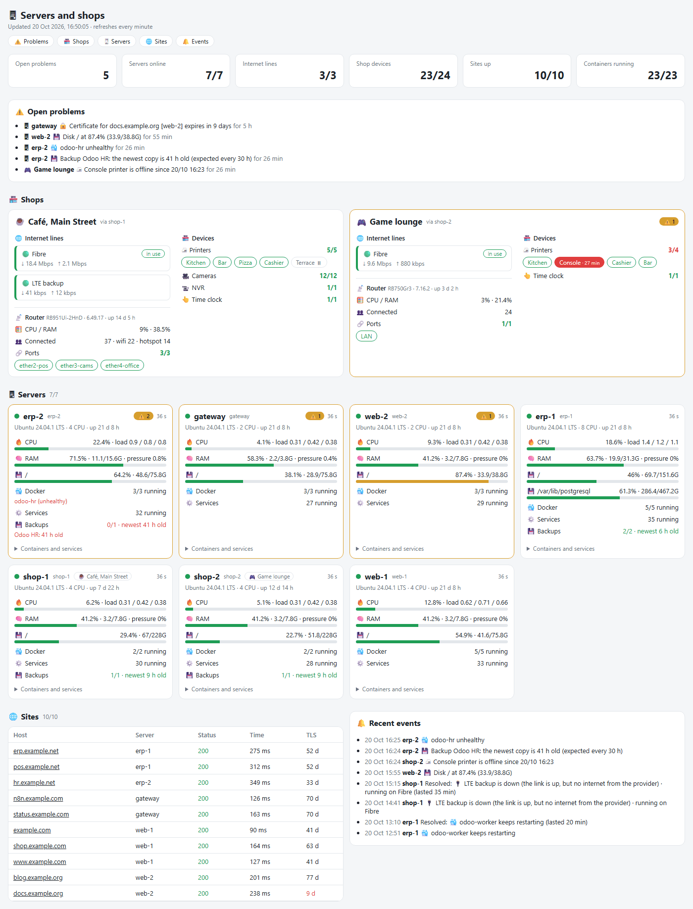
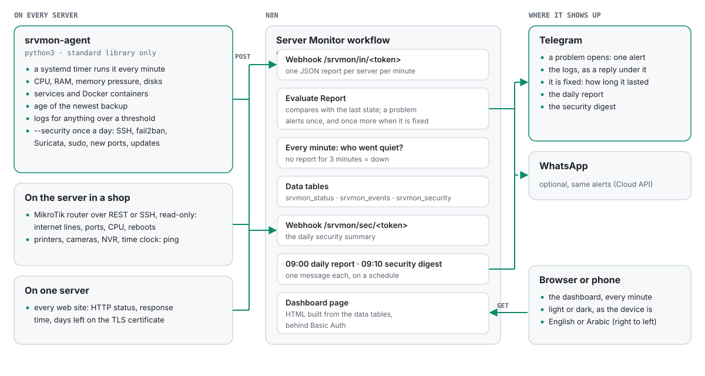
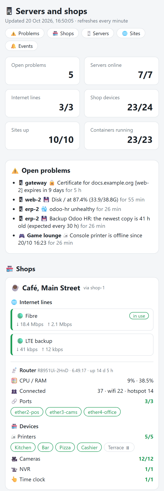
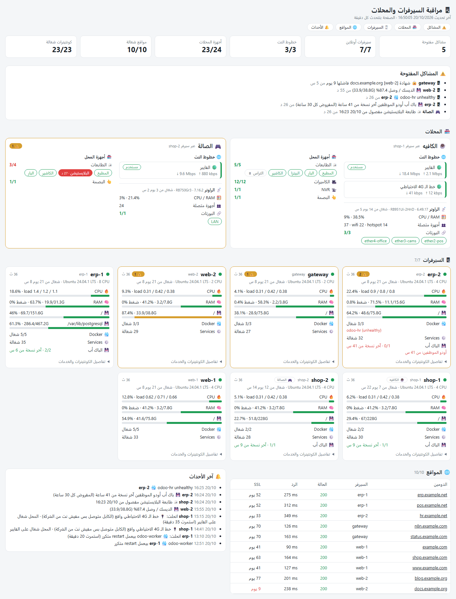

# srvmon

A small monitor for a handful of Linux servers. A Python agent on every server reports each minute to an n8n workflow, which keeps a dashboard, alerts on Telegram when something breaks and again when it is fixed, and sends a daily report and a daily security digest.

<picture>
  <source media="(prefers-color-scheme: dark)" srcset="assets/dashboard-dark.png">
  <source media="(prefers-color-scheme: light)" srcset="assets/dashboard-light.png">
  
</picture>

I run it on seven Ubuntu servers, with about ten Odoo instances and twenty-five web sites between them. Two of those servers sit inside shops, and there it also watches the router, the internet lines, and the printers, cameras and time clock on the shop's network. This repository is that setup with the names taken out; everything in the screenshots is made up.

## What it watches

| | |
|---|---|
| **The host** | CPU, load, RAM and memory pressure (PSI), every real disk, uptime |
| **Services** | failed systemd units |
| **Docker** | containers that are unhealthy, restarting, or stopped although they have a restart policy |
| **Backups** | the age of the newest file matching a pattern, per backup job |
| **Web sites** | HTTP status, response time, days left on the TLS certificate |
| **A shop's network** | a MikroTik router: each internet line, watched ports, CPU, and reboots (usually a power cut) |
| **A shop's devices** | printers, cameras, the NVR, the time clock, anything with an IP address |
| **Security, once a day** | failed and successful SSH logins, fail2ban bans, Suricata alerts, sudo, account changes, OOM kills, new listening ports, pending updates, reboot required |

## How it works

<picture>
  <source media="(prefers-color-scheme: dark)" srcset="assets/architecture-dark.svg">
  <source media="(prefers-color-scheme: light)" srcset="assets/architecture-light.svg">
  
</picture>

- **The agent pushes.** Nothing on the servers listens for the monitor and no port has to be opened. It is one Python file using only the standard library, so it runs on a fresh Ubuntu without pip, and a systemd timer starts it every minute.
- **Alerts on change, not on every reading.** Evaluate Report keeps each server's open problems in a data table. A problem has to appear in a few reports in a row before it alerts (two for a container, five for CPU), it alerts once, and when it clears you get one line saying how long it lasted. A server that sends nothing for three minutes is marked down.
- **The evidence comes with the alert.** When something crosses a threshold the agent attaches what you would look at first: the journal of a failed unit, the health check and `docker logs` of a container, `du` for a full disk, the top processes for RAM or CPU. It arrives as a reply under the alert.
- **One alert, not twelve.** When the NVR is down, the cameras behind it are not reported one by one. When a shop's backup line drops, the alert says which line the shop is running on now.
- **Memory pressure, not swap.** A full swap often only means idle pages were parked there. The agent reads `/proc/pressure/memory`, and the alert fires when tasks are actually waiting for RAM.

An alert, its logs, and the message when it is fixed:

```text
🖥 web-2
🔴 💾 Disk / at 87.4% (33.9/38.8G)

    🖥 web-2 · logs
    disk:/
    $ du -xh --max-depth=2 / | sort -rh | head -20
    33G   /
    19G   /var
    9.8G  /var/lib/docker
    6.1G  /var/log
    ...

🖥 shop-1
✅ Resolved: 🔌 LTE backup is down (the link is up, but no internet from the provider) · running on Fibre (lasted 35 min)
```

In my own setup the same logs also go to an LLM node, which writes a first guess at the cause under the alert, and the alerts are copied to WhatsApp. The template has the WhatsApp node switched off and leaves the LLM out, so it runs with nothing but a Telegram bot.

## Install

You need an n8n instance recent enough to have **Data tables**, a Telegram bot, and Python 3.9 or later on the servers. I run it on Ubuntu; any systemd distribution should do.

### 1. The workflow

1. In n8n, create three data tables (Overview → Data tables):

   | table | columns |
   |---|---|
   | `srvmon_status` | `server` string, `online` boolean, `last_seen` number, `payload` string, `state` string |
   | `srvmon_events` | `server` string, `kind` string, `message` string, `ts` number |
   | `srvmon_security` | `server` string, `ts` number, `report` string |

2. Import [`n8n/srvmon-workflow.json`](n8n/srvmon-workflow.json) (Workflows → Import from file).
3. Replace `CHANGE-ME` in the webhook paths: one long random token (`openssl rand -hex 16`) in **Agent Report** and **Security Report**, the same in both, and a different one in **Dashboard Page**.
4. Pick a Basic Auth credential in **Dashboard Page**, your Telegram credential in the four Telegram nodes, and put your chat ID in them.
5. At the top of the Code nodes, set `KNOWN` to your server names (in **Evaluate Report** and **Check Security Report**), and if you like `LANG`, `SHOPS` and `DASHBOARD_URL`.
6. In the workflow settings, set the time zone and turn off saving successful executions; one execution per server per minute adds up quickly. Then activate it.

### 2. The agent, on each server

```bash
git clone https://github.com/ahmedbebars/srvmon.git
cd srvmon/agent
sudo ./install.sh
```

The first run writes a minimal `/etc/srvmon/agent.json` and stops. Put in the server's name (the same as in `KNOWN`) and the Agent Report URL, `https://<your n8n>/webhook/srvmon/in/<token>`, then run `sudo ./install.sh` again. That installs the [systemd units](agent/systemd/) and sends the first report. Within a minute the server is on the dashboard and Telegram says it was added.

To see what the agent would send, set `"url": "-"` in a copy of the config and run `python3 srvmon-agent that-copy.json`; it prints the report instead.

On a server without sudo, `./install.sh --user` puts the agent in `~/.local/bin` and runs it from crontab. The security summary then needs the user in the `adm` or `systemd-journal` group to read the journal.

### 3. A shop's router (optional)

The agent reads a MikroTik router with a user that can only read. Over the REST API (RouterOS 7, `www-ssl` enabled; port 8443 by default):

```text
/user group add name=monitor policy=read,rest-api
/user add name=watcher group=monitor password=<a long password>
```

and on the server, `/etc/srvmon/router.env` (mode 600):

```text
ROUTER=192.168.88.1
WATCH_USER=watcher
WATCH_PASS=<the password>
```

Where REST is not available, it logs in over SSH with a key instead, as a user whose group has only `ssh,read`, and runs one read-only script. Set `"via": "ssh"`, `host`, `user`, `key` and `known_hosts` in the `router` section.

A line counts as up when its interface is running and its default route is active: give each line either the `probe` address its recursive route checks (the usual MikroTik failover setup) or its plain upstream `gateway`.

## Configuration

### agent.json

[`agent/agent.example.json`](agent/agent.example.json) has every option.

| key | |
|---|---|
| `server` | the server's name; it must be in `KNOWN` in the workflow, or its reports are dropped |
| `url` | the Agent Report webhook URL, or `"-"` to print the report |
| `security_url` | where `--security` posts; by default `url` with `/srvmon/in/` changed to `/srvmon/sec/` |
| `sites` | `[{"host", "owner"}]`, checked over HTTPS each minute. Usually only one server checks all the sites; `owner` is the server that hosts the site |
| `backups` | `[{"label", "path", "max_age_h"}]`; `path` is a glob, and the alert fires when the newest match is older than `max_age_h` (default 30) |
| `router` | `env` (or `via: "ssh"` with `host`, `user`, `key`, `known_hosts`), `lines: [{"id", "label", "iface", "probe" or "gateway"}]`, `watch_ports`, and `port` for REST if it is not 8443 |
| `devices` | `items: [{"group", "id", "name", "ip"}]`, pinged each minute. Instead of `ip`, `state` names a JSON file your own watchdog keeps (`{"up": true}`). `quiet: "01:00-11:30"` for a device switched off every night, `off: true` for one that is off until further notice. `min_down_s` (default 180) is how long pings must fail before it counts as down; `tz` sets the clock for `quiet` |

Device groups the dashboard knows are `printer`, `camera`, `nvr`, `iot` and `clock`; any other group is shown under its own name.

### The workflow

| setting | node | |
|---|---|---|
| `LANG` | every Code node that writes text | `'en'`, or `'ar'` for Egyptian Arabic; the dashboard turns right to left |
| `KNOWN` | Evaluate Report, Check Security Report | the server names allowed to report |
| `SHOPS` | Build Dashboard | display names for shop servers, e.g. `{ 'shop-1': '☕ Main street café' }` |
| `DASHBOARD_URL` | Build Daily Report | adds a link to the dashboard at the end of the report |
| `DISK_PCT`, `MEM_PCT`, `CPU_PCT`, `SSL_DAYS` | Evaluate Report | thresholds: 85 %, 92 %, 95 %, 14 days |
| `SILENT_MS` | Find Silent Servers | how long without a report before a server is down; 3 minutes |

The Code nodes live as plain files in [`n8n/code/`](n8n/code/). After changing one, `python3 n8n/build_workflow.py` rebuilds the import file.

## Security

- The webhook paths carry long random tokens. Reports from a name that is not in `KNOWN` are dropped, as is anything over 500 KB, and every number is checked before it is stored.
- The dashboard sits behind Basic Auth, escapes every value it shows, and is sent with `noindex`, `no-referrer`, `nosniff` and `no-store`.
- The router account can only read: a REST group with `read,rest-api`, or a key-only SSH user with `ssh,read`.
- The agent runs as root, because it reads the journal, Docker and every disk. It opens no port and only makes outgoing connections: to n8n, to the sites it checks, and in a shop to the router and the devices it pings.

## Try the Code nodes without n8n

[`tools/demo`](tools/demo/) runs the workflow's Code nodes on a made-up fleet of seven servers: five hours of reports, with problems that come and go.

```bash
cd tools/demo
npm install
node run.js
```

It writes the dashboard, the daily report, the security digest and the alerts to `out/`, in English and in Arabic. The screenshots on this page come from it.

## Arabic, and phones

Set `LANG = 'ar'` and the alerts, the reports and the dashboard are in Egyptian Arabic, the way I run it. The page works on a phone, and follows the phone's light or dark theme.

<p>
  <picture>
    <source media="(prefers-color-scheme: dark)" srcset="assets/dashboard-mobile-dark.png">
    
  </picture>
  <picture>
    <source media="(prefers-color-scheme: dark)" srcset="assets/dashboard-ar-dark.png">
    
  </picture>
</p>

## In this repository

```text
agent/srvmon-agent          the agent (Python 3, standard library only)
agent/install.sh            installs it with systemd timers, or with crontab (--user)
agent/systemd/              srvmon-agent every minute, srvmon-security once a day
agent/agent.example.json    every config option
n8n/srvmon-workflow.json    the workflow, ready to import
n8n/code/                   the Code nodes as plain JavaScript
n8n/build_workflow.py       rebuilds the import file from n8n/code/
tools/demo/                 runs the Code nodes outside n8n on made-up data
```

## License

[MIT](LICENSE)
